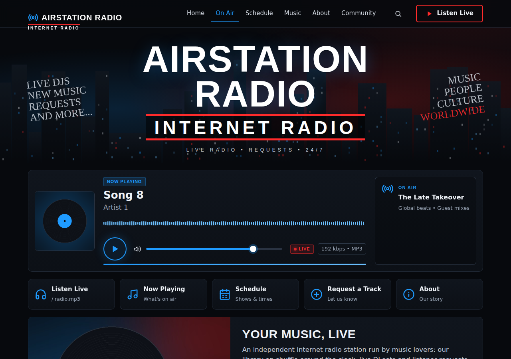
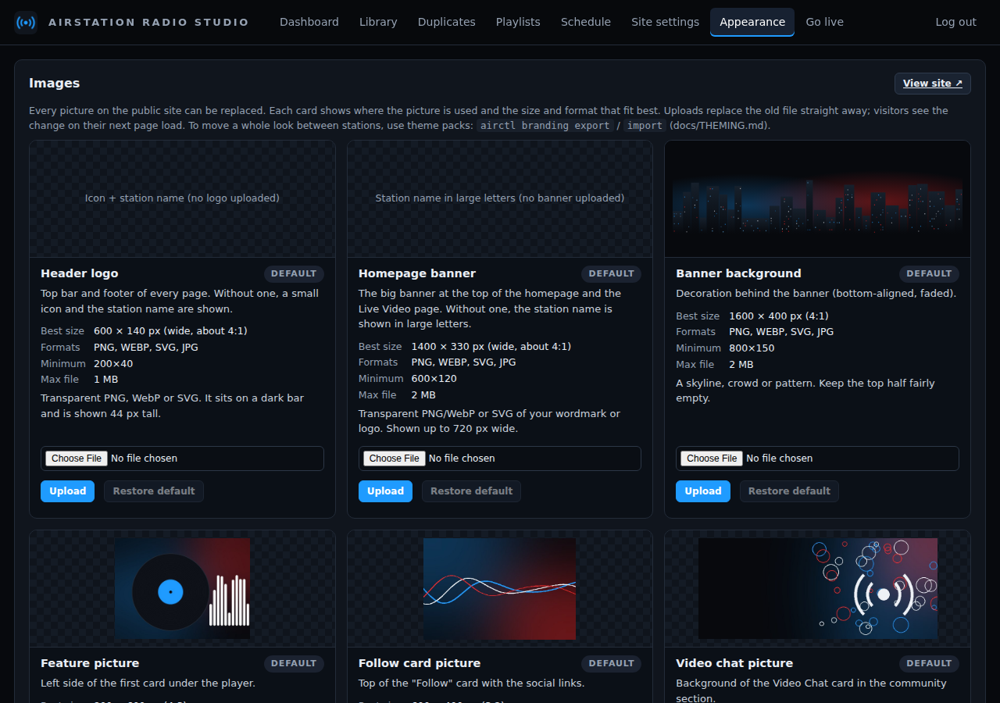
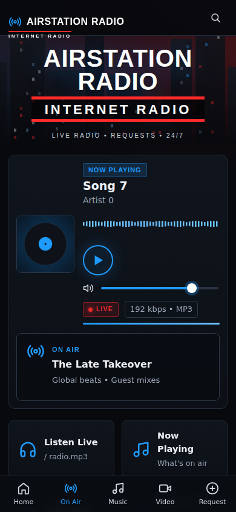

# AirStation

**Self-hosted internet radio for a small VPS:** an AutoDJ that plays your own music
library, live takeover from Mixxx or OBS, a responsive station website, and a web
admin ("Studio") to run it all. Inspired by AzuraCast, with a stronger focus on
playlist management, live switching, and running from a home music library.



> **Version 2.5.** A 30-day trial is built in; a lifetime licence unlocks Studio after
> that (the station itself never stops broadcasting). See [docs/LICENSING.md](docs/LICENSING.md).

## Features

- **AutoDJ from a home music library.** The library is reached over WireGuard + SMB
  (the reference setup is a MikroTik router's USB share), indexed, and cached on the VPS,
  so the station keeps playing when home is offline. An emergency folder covers
  everything else.
- **Playlist management.** Playlists by folder, genre tag or hand-picked tracks; a
  weekly show schedule; a fair shuffle of the whole library with artist spacing;
  listener requests; "play next".
- **Live takeover.** Mixxx (Icecast protocol, port 8005) or OBS (SRT/RTMP through
  MediaMTX) goes on air when the current song ends, or instantly. AutoDJ comes back when
  you stop, or after 15 s of silence. Live sets can be recorded automatically.
- **Cover art** read from embedded tags (including WebP covers), repaired automatically;
  a **duplicate finder** for the library.
- **Station website**: player with cover art and progress, recently played, schedule,
  search and requests, community links, phone layout, and a **Live Video** page for an
  Owncast stream with chat.
- **Your look, no code needed.** In **Studio > Appearance**: logo, banner and every
  picture (each with its recommended size and format), every page text, colours, plus
  custom CSS and JavaScript on every public page, like AzuraCast. Looks can be exported
  and shared as **theme packs**. See [docs/THEMING.md](docs/THEMING.md).
- **Listener statistics and audience map** in **Studio > Listeners**, like AzuraCast's:
  where listeners and website visitors are on a world map, how long people listen,
  listeners over time, most at once, countries, players and apps, and a CSV export.
  Self-hosted, cookieless and without stored IP addresses; the map uses OpenStreetMap
  with no API key. See
  [docs/STATISTICS.md](docs/STATISTICS.md).
- **Community add-on (optional):** a NodeBB forum with chat, and station accounts with
  single sign-on and passkeys through Rauthy.
- **HTTPS** by Caddy with automatic certificates. Streams: `/radio.mp3` (192 kbps),
  `/radio-low.mp3` (96 kbps data saver) and `/radio.m3u8` (HLS, AAC) for IPTV apps,
  smart TVs and M3U playlists. Studio > Go live has the addresses and a ready-made
  playlist entry.

| Studio: Appearance | Phone |
|---|---|
|  |  |

## How it fits together

Docker Compose runs Caddy, Icecast, Liquidsoap, MediaMTX and a small standard-library
Python API (SQLite). A systemd timer on the host copies music from the home share into
a local cache. Details: [docs/ARCHITECTURE.md](docs/ARCHITECTURE.md).

Tested on: Debian 13, 2 vCPU / 4 GB RAM / 80 GB disk, Docker with Compose v2.

## Quick start

Full guide with a check after every step: **[docs/DEPLOY.md](docs/DEPLOY.md)**.

```bash
# On the VPS, as root, with the zip uploaded to /root. It must live in /opt/air-station.
apt install -y unzip python3 ffmpeg cifs-utils wireguard-tools curl
cd / && unzip -q /root/air-station-v2.5.0.zip -d /opt && cd /opt/air-station
python3 scripts/init.py --domain radio.example.com --email you@example.com
bash scripts/preflight.sh
# put a few MP3s in data/emergency/, then:
docker compose pull --ignore-buildable && docker compose build
bash scripts/airctl check-config        # must print "radio.liq OK"
docker compose up -d && sleep 20 && bash scripts/check.sh
```

Then open `https://radio.example.com/admin/` (the password is printed by `init.py`,
and again by `bash scripts/airctl creds`) and make the station yours in **Appearance**. Enter your licence key in **Licence**
(the trial runs for 30 days). For the listener map, run
`bash scripts/airctl geoip update` once.

Adding the home library: [docs/DEPLOY.md](docs/DEPLOY.md) steps 7–9 and
[docs/MIKROTIK.md](docs/MIKROTIK.md).

## Documentation

| Guide | What it covers |
|---|---|
| [DEPLOY.md](docs/DEPLOY.md) | Step-by-step installation |
| [MIKROTIK.md](docs/MIKROTIK.md) | WireGuard + SMB link to a MikroTik router (and a home-Linux fallback) |
| [OPERATIONS.md](docs/OPERATIONS.md) | Day-to-day use, `airctl`, backups, troubleshooting |
| [STATISTICS.md](docs/STATISTICS.md) | Listener statistics, the map, location data and privacy |
| [THEMING.md](docs/THEMING.md) | Images and sizes, page texts, colours, custom CSS/JS, theme packs |
| [ARCHITECTURE.md](docs/ARCHITECTURE.md) | How it fits together and why |
| [COMMUNITY.md](docs/COMMUNITY.md) / [COMMUNITY-SETUP.md](docs/COMMUNITY-SETUP.md) | Forum and single sign-on add-on |
| [LICENSING.md](docs/LICENSING.md) | Trial, activating your key, moving server |
| [UPDATING.md](docs/UPDATING.md) | Upgrading an existing install; see also [CHANGELOG.md](CHANGELOG.md) |

## Tests

```bash
python3 -m unittest discover -s tests -v     # needs python3 and ffmpeg
python3 tests/devserver.py                   # local preview of the site (see the file)
```

The tests cover tag and cover-art reading, schedules, the fair shuffle, requests, NAS
indexing/copying/eviction, theming, GeoIP lookups, listener statistics, and the full HTTP API against a simulated
Liquidsoap. They only use temporary files.

## Licence

AirStation is commercial software: see [LICENSE](LICENSE). One lifetime licence covers
one station. Third-party programs it runs with (Icecast, Liquidsoap, Caddy, MediaMTX and
others) keep their own open-source licences: see
[THIRD-PARTY-NOTICES.md](THIRD-PARTY-NOTICES.md). Support: [SUPPORT.md](SUPPORT.md).
